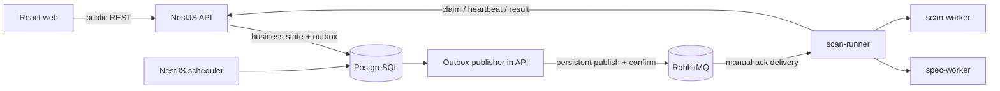
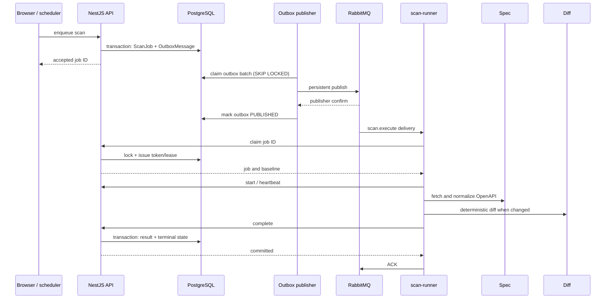
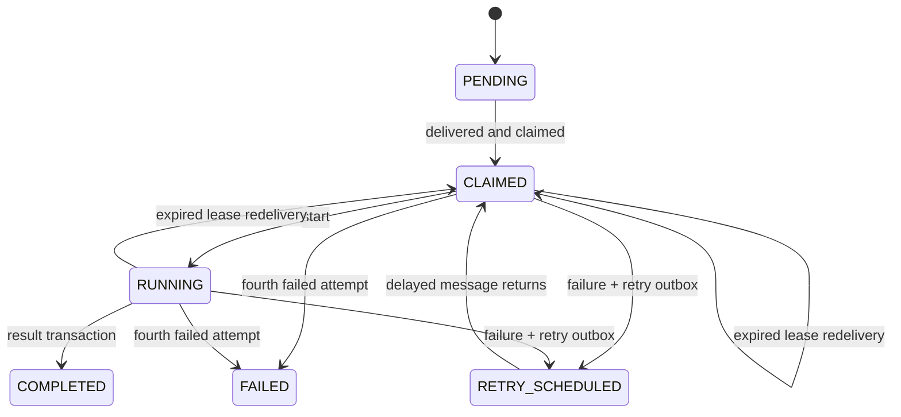

# Contrava architecture

## System overview

NestJS is the control plane and the sole owner of PostgreSQL. PostgreSQL is authoritative for APIs, schedules, snapshots, changes, scans, job state, leases, and outbox state. RabbitMQ provides push delivery, delayed retry queues, acknowledgements, and dead letters. A message never replaces the `ScanJob` row.

The runner and deterministic workers do not open PostgreSQL. The runner consumes RabbitMQ and uses explicitly internal HTTP endpoints to claim a delivered job, manage its lease, and persist its result. The existing PostgreSQL batch-claim endpoint remains available only when `JOB_DELIVERY_MODE=postgres-polling` is selected as a fallback.

## Enqueue and delivery

The enqueue transaction closes the database/broker dual-write gap. The outbox publisher never holds row locks while talking to RabbitMQ. Publisher confirms prove broker acceptance, but a crash between confirmation and the outbox update can still duplicate delivery; consumers are intentionally idempotent.

## Job state, retries, and ownership

Claims increment `attempt`, create a random token, record runner identity, and set a lease. Lifecycle calls require the current token and runner ID. Heartbeats extend only active, unexpired leases. A stale runner cannot complete after reclaim.

Failures schedule 5-second, 15-second, and 60-second broker stages. The retry state and retry outbox message commit together. The fourth failed attempt is terminal and its delivery is rejected to `contrava.scan.dead`.

## Idempotency and ordering

The message envelope contains IDs only. On every delivery, the API locks and inspects the durable job:

- `COMPLETED` is a safe duplicate and is ACKed without execution;
- an unexpired active job is busy, so delivery is held briefly and requeued;
- an expired active job is reclaimed with a new token;
- terminal/missing work is rejected to the DLQ.

`(apiId, contentHash)` prevents duplicate snapshots. Completion accepts repeat calls for an already completed job. A per-API row lock serializes snapshot baseline movement without blocking unrelated APIs. Scheduler row locks plus unique `scheduleKey` values prevent duplicate schedule slots.

## Backpressure and shutdown

RabbitMQ prefetch is normally equal to runner concurrency, so a runner does not reserve more messages than it can process. During graceful shutdown it cancels consumption, waits up to the configured grace period for active jobs, then closes the channel; any remaining unacknowledged messages return to RabbitMQ. Leases protect application ownership across those redeliveries.

## Persistence and transport boundaries

- **PostgreSQL:** authoritative business state, idempotency, leases, attempts, and outbox.
- **RabbitMQ:** at-least-once notification delivery, delayed routing, acknowledgements, and DLQ.
- **NestJS API:** only database client; publisher confirms and internal lifecycle validation.
- **scan-runner:** broker consumer and HTTP orchestrator; no direct database access.
- **spec/scan workers:** deterministic bounded HTTP computation; no queue or database access.

See [RabbitMQ delivery](rabbitmq-delivery.md), [PostgreSQL concurrency](postgres-concurrency.md), and [performance](performance.md).
