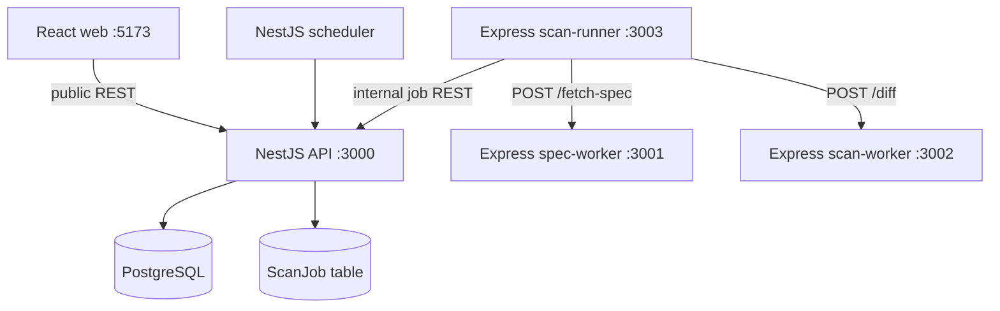
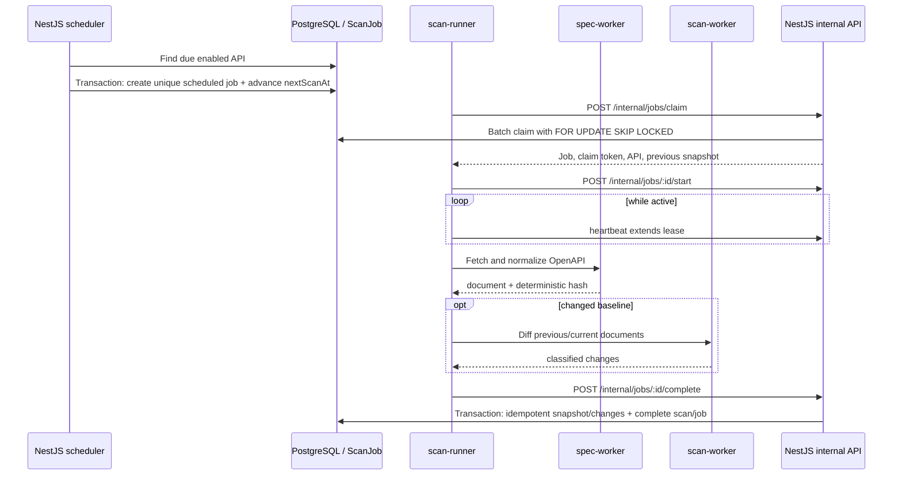
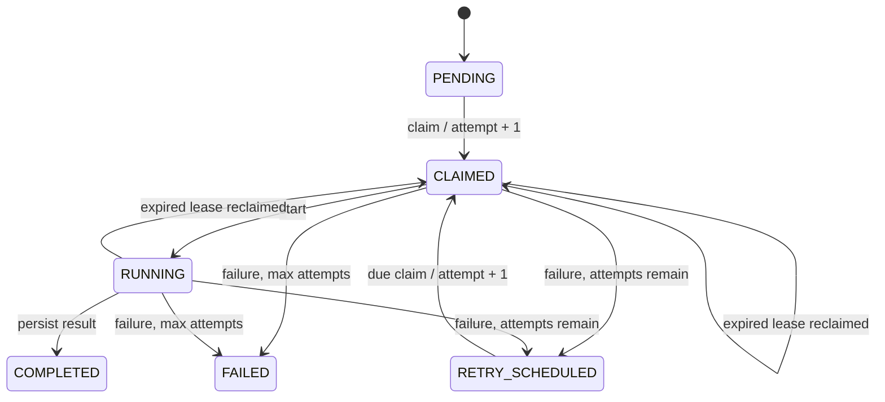

# Contrava architecture

## System overview

React provides the dashboard, schedule controls, and job visibility. TanStack Query owns remote state and React Router keeps workflows addressable. NestJS is the control plane and sole owner of PostgreSQL. It validates public and internal HTTP contracts, schedules work, coordinates leases, and transactionally persists scan output. The lightweight Express workers remain independently startable.

The scan-runner is a separate polling process. It never opens PostgreSQL: claims, heartbeats, results, and failures all pass through explicitly marked `/internal/jobs` endpoints. This keeps database ownership in the API while allowing multiple runner processes.

Native Node.js APIs remain visible: `fetch` and `AbortController` implement bounded calls, `crypto` creates request/claim IDs, `os.hostname` contributes runner identity, timers drive polling/heartbeats/scheduling, and process signals initiate graceful shutdown.

## Scheduled scan flow

Manual **Scan now** requests enter the same queue and follow the same path. There is no second synchronous implementation.

## Job state and ownership

A claim stores a random token, runner ID, claim time, and lease expiry. A short PostgreSQL transaction selects an ordered batch using `FOR UPDATE SKIP LOCKED` and updates ownership before committing. Competing runners skip locked rows and claim different jobs. Lifecycle calls must present the current token. A heartbeat extends only an unexpired lease. If a runner disappears, another runner can reclaim the job after expiry and receives a new token; stale completion is rejected.

Claims increment `attempt`. Failures use deterministic durable delays: 5 seconds after attempt one and 15 seconds after attempt two. At `maxAttempts`, the job becomes terminally `FAILED`. Small HTTP retries handle transient transport errors; they do not replace persisted job retries.

The runner requests a batch equal to its free capacity and claims only while `activeJobs < MAX_CONCURRENT_JOBS`. It does not preload an in-memory queue, so `ScanJob` remains the source of truth and provides basic backpressure. Multiple runner processes can share that source safely.

## Scheduling and duplicate prevention

Enabling a schedule sets `nextScanAt` to now. Every scheduler tick reads a bounded set of due APIs. For each, a transaction locks and rechecks the due API row, creates a job with a unique key made from API ID and scheduling slot, and advances the exact due timestamp. Concurrent/repeated ticks therefore cannot create the same slot twice. Missed intervals are skipped rather than producing an unbounded catch-up burst.

## Idempotency and failure recovery

`(apiId, contentHash)` remains unique. Completion first checks for an existing hash, so repeated completion cannot duplicate a snapshot. A completed job accepts duplicate completion calls as success. Snapshot, changes, scan status, API status, and job completion are written transactionally. The completion also verifies the runner's previous snapshot baseline; concurrent baseline movement causes a retry instead of applying a stale diff.

On graceful runner shutdown, new claims stop, active jobs receive a configurable grace period, and heartbeats continue while those jobs finish. If the process is killed or grace expires, unfinished jobs retain their leases; another runner recovers them after expiry.

## Why this is not a full message queue

PostgreSQL supplies durable rows, row locks, and transactions, but there is no broker push delivery, acknowledgement protocol, routing, partitioning, dead-letter queue, or high-throughput concurrent writer design. Polling adds latency and database load. This implementation is intentionally useful for learning: leases, ownership, retries, idempotency, backpressure, and crash recovery are explicit and inspectable.

A future Redis/BullMQ or RabbitMQ phase would replace job polling, broker delivery, acknowledgements, retry timing, and dead-letter handling. NestJS would still own product state and idempotent result persistence; deterministic OpenAPI workers would remain separate.

## Persistence boundaries

The NestJS API owns `TrackedApi`, `ApiSnapshot`, `ApiChange`, `Scan`, `ScanJob`, and `Worker` data in PostgreSQL. Workers and runners do not share the database. PostgreSQL permits concurrent consumers while API-row locking preserves each contract's snapshot order. See [PostgreSQL concurrency](postgres-concurrency.md) and [performance](performance.md) for the detailed model.
