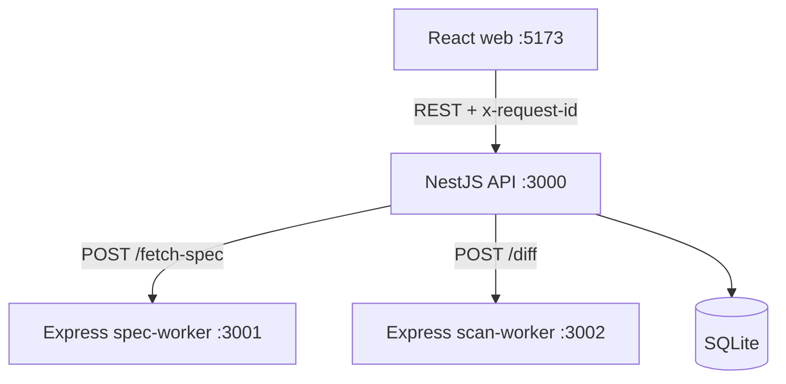
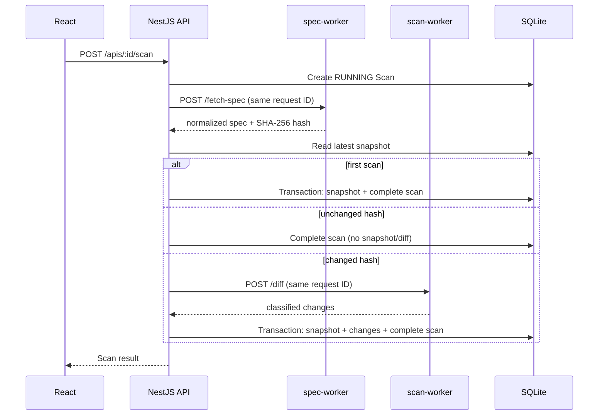

# Contrava architecture

## System overview

React is used because the product is an interactive dashboard whose server state maps naturally to TanStack Query. React Router keeps each workflow addressable without introducing a larger state framework.

NestJS is the application control plane. Modules make ownership of tracked APIs, snapshots, changes, scans, worker clients, and health explicit. Dependency injection keeps orchestration testable, validation pipes protect HTTP DTOs, and middleware establishes correlation IDs. Nest uses its default Express adapter.

The two workers use Express directly. Their APIs are small, stateless, and deliberately expose the underlying Node.js mechanics instead of needing Nest's application structure. Native `fetch`, `AbortController`, `URL`, `crypto`, timers, HTTP servers, environment variables, and process signals are used for fetching, hashing, timeouts, startup, and graceful shutdown.

## Scan request flow

Every service-to-service call has an abort timeout. Transient failures are attempted at most three times, with 250 ms and 500 ms waits. Worker 4xx responses are not retried. The API-generated or caller-provided `x-request-id` is propagated to both workers and included in structured request logs.

The changed snapshot is written only after diffing succeeds, and snapshot/change writes happen in one transaction. If the diff worker fails, the scan is marked `FAILED` while the previous baseline remains authoritative. A retry is therefore safe. `(apiId, contentHash)` is unique, and unchanged hashes bypass persistence, preventing duplicate snapshots and changes in normal operation.

## Persistence

The NestJS application owns SQLite through Prisma:

- `TrackedApi`: registration, URL, status, and last-check time.
- `ApiSnapshot`: immutable raw normalized document and deterministic hash.
- `ApiChange`: classified difference between two snapshots.
- `Scan`: lifecycle and failure details for an attempt.
- `Worker`: durable shape reserved for later registration/heartbeats; phase one health is live.

SQLite is appropriate for a local, single-control-plane learning phase: it is inspectable, requires no separate server, and supports the needed transactions and constraints. It is not intended for horizontally scaled writers. PostgreSQL is the next durable store once concurrency demands it.

Workers are stateless and never open the control-plane database. As the system grows, each service that needs durable state should own its schema and expose behavior over a contract. This avoids a shared-database coupling that would make independent deployment and schema evolution unsafe.

## Distributed-system boundaries

Distributed concerns already appear despite local deployment: unavailable workers, malformed remote documents, slow networks, retries, duplicate requests, partial failure, health aggregation, and cross-service log correlation. The implementation keeps those policies visible rather than hiding them in a generic framework. Later phases can introduce asynchronous delivery and tracing after the synchronous behavior is understood.

The shared package contains only wire-level contracts such as severities, diff results, OpenAPI response types, and worker health. Database models and internal services remain private to their owners.
